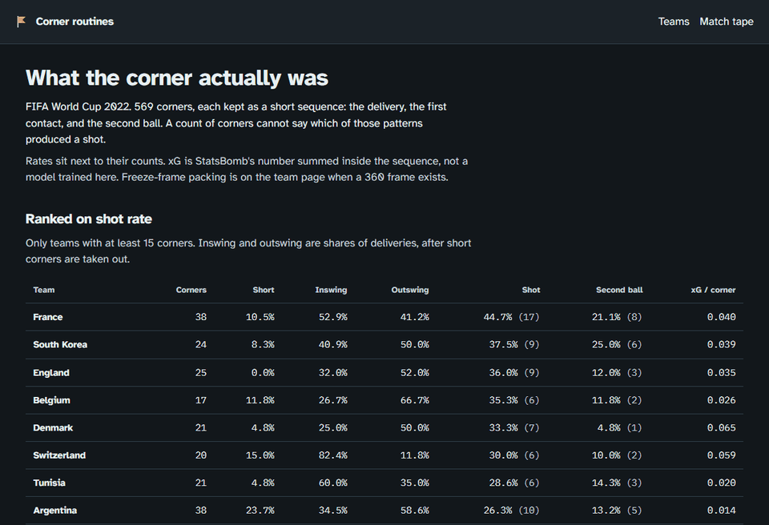

# Corner routines

[Live site](https://football-corner-routines.vercel.app) · [source](https://github.com/NoorSbeih/football-corner-routines)



When a team takes a corner, what do they actually do, and which of those patterns become a shot?

FIFA World Cup 2022, from StatsBomb open data. 569 corners. 27.9% of them produced a shot (159). 12.1% produced that shot from the second ball (69). 12 became goals.

This is not a count of corners, and it is not a pass map. A team can take eight corners and have them all be the same short routine, or eight different crosses. The page keeps each corner as a short sequence: delivery, first contact, second ball, then a shot or a clearance.

## How a sequence is cut

A corner is a pass whose type is `Corner`. The shootout (period 5) is ignored.

**Short** if the pass is complete, the end point is outside the penalty box, and it finishes within 20 yards of the flag. In this tournament those are ground passes with no swing label, about 14% of corners (81). A short corner that is crossed afterwards is still one sequence. The cross is not a second corner.

**Delivery** otherwise: inswing, outswing, straight, or unmarked when the technique field is missing.

The sequence starts at the corner and stops at the first of:

- a goal
- the next restart (throw-in, goal kick, another corner, free kick, kick-off, penalty)
- 8 seconds after the first contact
- the end of the period

The first contact is the first on-ball action after the corner: a receipt, header, shot, clearance, or similar. A shot by that same player, after only their own receipt or carry, is a first-contact shot. A header or any other player's touch, and then a shot, is a second ball.

StatsBomb's "From Corner" pattern lasts longer than this window. Olivier Giroud's header against England is tagged that way and is not counted here: the corner had already been cleared, and the goal came about 10 seconds after the first contact. The 8 seconds are in `config/pitch.yaml`.

xG is the sum of `shot_statsbomb_xg` on attacking shots inside the sequence. Nothing here trains an xG model.

## Zones

The attacking team always plays toward x = 120 on StatsBomb's 120 × 80 pitch. The other team's touches are flipped into that frame. The left flag is y = 80 (the attacker's left). The right flag is y = 0.

```
y = 80  left flag
        +---------------------------+  goal line, x = 120
        | six-yard  x >= 114        |
        |   near post | centre | far|
        | penalty box x >= 102      |
        |   edge | penalty spot | edge
y = 0   right flag
```

Near and far swap with the flag. Between the posts (y 36 to 44) the six-yard box is its own zone, and the middle of the penalty box outside it is the penalty spot. Wide of that, still in the box, is the edge. A deliberate short corner is zone `short`, not a failed cross.

In this World Cup the penalty spot was the contact that most often led to a shot (36.5%, 126 corners). The near post was quieter (20.4%, 98). The far-post strip inside the six-yard box was rare (11 corners), so it almost never clears the sample floor for one team. Outswinging deliveries produced shots more often than inswinging ones: 34.0% of 206, against 23.5% of 234.

The cells that clear 8 corners are not the same routine. France's outswing to the penalty spot was 5 shots from 8. Brazil's inswing to the near post was 0 from 8. Short corners split the same way: Argentina 4 from 9, Spain 2 from 12, Brazil 0 from 9. Small samples still, which is why the count is on the screen.

## 360 frames

Where a match has StatsBomb 360 data, the freeze frame on the corner (or, if that event has no frame, on the first shot) counts attackers and defenders inside the penalty box. `teammate` is the taker's team. Across the corners that have a frame, the median box is 5 attackers and 10 defenders.

369 of 569 corners have a frame. The rest are null. The median ignores them. A missing 360 file does not stop the build.

Packing is not marking. The frame says how many bodies were in the box, not who was picked up.

## What this will not rank

- A team with fewer than 15 corners stays on the table and out of the shot-rate ranking.
- A technique × zone cell with fewer than 8 corners shows the count and the words "n too small", not a percentage.
- Goals are a raw count. Twelve goals is not a leaderboard.
- Opponent marking and goalkeeper quality are not in the event data.
- Set-piece xG is noisy. It is a column, not the title.

## Architecture

StatsBomb events and 360 frames, cached as Parquet, loaded into DuckDB (`raw` → `staging` → `marts`), exported to JSON, rendered by a static Next.js app. Prefect runs extract → load → transform → export. The site does not need DuckDB at runtime.

Pitch constants live only in `config/pitch.yaml`. The tests use that file.

## Run it locally

```bash
python -m venv .venv
pip install -e ".[dev]"
corner-routines build --competition wc2022
cd web && npm ci && npm run dev
```

The first build downloads StatsBomb data. Later builds use `data/raw/` and do not refetch. Parquet, the 360 dumps, and the DuckDB file are gitignored. The JSON under `web/public/data/` is what the site ships.

Open `/` for the team table, a team link for the penalty-box plot, and Match tape for the match with the most corners (Denmark 0-0 Tunisia, 20).

## Deploy

The live site is [football-corner-routines.vercel.app](https://football-corner-routines.vercel.app). The Vercel project root is `web/`. `npm run build` writes `web/out/`, and `web/vercel.json` publishes that folder with clean URLs, so `/team/771` serves `team/771.html`. The build does not need DuckDB or the Parquet cache, because the JSON is already in `web/public/data/`.
